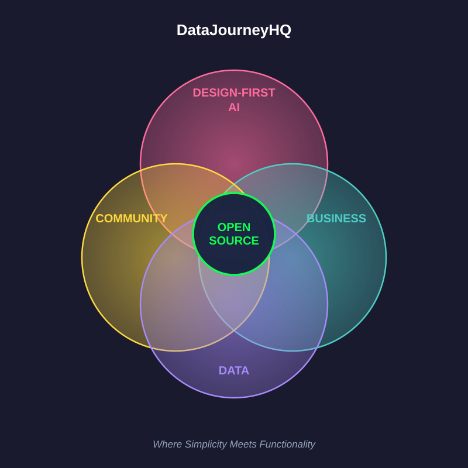

<!-- 

  

 -->

https://github.com/user-attachments/assets/970911a0-5650-43a1-b5ed-7dde97519577

## Our home ground 🛠️

| Type/Focus | Maintained | Project | What it helps you do |
| --- | --- | --- | --- |
| **Tool** | Yes| [DataJourney](https://github.com/DataJourneyHQ/DataJourney) | Build reproducible, design-first workflows for the PyData ecosystem. |
| **Discover** | Yes | [DataJourneyHQ Academy](https://academy.datajourneyhq.com/) | Build production-ready AI systems through coaching, workshops and guides grounded in open source. |
| **Retain** | Yes | [Academy Demos](https://github.com/DataJourneyHQ/DemoWorld) | Explore real-world AI systems combining deterministic workflows with LLM-driven decisions. |
| **Usecase** | Yes | [Bill se Khata](https://chatgpt.com/plugins/plugins_6a95718797008191b2d849c8d95779c8) | Turn printed or handwritten Indian receipts and invoices into an itemised Excel ledger with GST, reconciliation checks, spend analytics and a human-review queue. |
